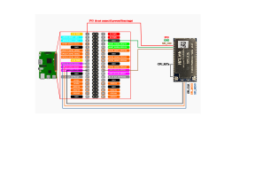

# HLK-7628N firmware recovery over SPI

How to read and write the SPI flash of a Hi-Link HLK-7628N module with a
Raspberry Pi and flashrom. You need this when the module does not start at
all, typically because its bootloader (U-Boot) was damaged.

## Before you open anything

- **Module still starts (U-Boot works):** you do not need SPI. Install
  OpenWrt from the U-Boot menu over TFTP, as described in the
  [OpenWrt commit that added the HLK-7628N](https://github.com/openwrt/openwrt/commit/671c9d16e382)
  (UART0, 57600 baud, menu item 2).
- **Never use the Hi-Link web update page for OpenWrt images.** On a module
  with Hi-Link firmware it overwrote the start of U-Boot, and the module did
  not start again (see [flash_data/README.md](flash_data/README.md)).
- On modules delivered with Hi-Link firmware we saw no output on the UART,
  so the TFTP route could not be used. This is not yet understood.

## Flash layout

| Offset | Size | Partition | Contents |
|---|---|---|---|
| 0x000000 | 0x30000 | u-boot | bootloader |
| 0x030000 | 0x10000 | u-boot-env | bootloader settings |
| 0x040000 | 0x10000 | factory | **per module**: MAC addresses, Wi-Fi calibration |
| 0x050000 | rest | firmware | kernel + root filesystem (an OpenWrt sysupgrade image) |

The same layout is in [hlk-7628n.layout](hlk-7628n.layout) for flashrom.
`factory` is unique to each module. Never write it from another module's
image: the module would get a duplicate MAC address.

## Connection



- MOSI, MISO, CLK, CS0 and GND to the Raspberry Pi SPI0 pins as shown.
- Tie **CPU_RSTn** to GND. This holds the MT7628 in reset so that it does
  not drive the SPI lines.
- Connect 3.3 V from the Raspberry Pi only if the module is not powered by
  the target board.

## Preparing the Raspberry Pi

Enable SPI (`sudo raspi-config` → Interface Options → SPI, or
`dtparam=spi=on` in `/boot/firmware/config.txt`), reboot, check that
`/dev/spidev0.0` exists, and install flashrom:

```sh
sudo apt update
sudo apt install flashrom
```

The commands below use

```sh
FR="sudo flashrom -p linux_spi:dev=/dev/spidev0.0,spispeed=1000 -c W25Q256JV_Q"
```

`spispeed` is in kHz. 1 MHz is slow (a full read takes about 5 minutes) but
reliable with jumper wires. A read at a too high speed gives random data
without any error message.

## 1. Check the connection

```sh
$FR
```

flashrom must report the W25Q256 chip. Without `-c` it may list several
candidates; use the one it names.

## 2. Back up the flash

Read it twice and compare. Only continue when both reads are identical.

```sh
$FR -r backup1.bin
$FR -r backup2.bin
cmp backup1.bin backup2.bin && echo OK
```

Keep the backup. Its `factory` region is the only copy of the module's MAC
addresses and calibration.

## 3. Write

Write only the regions you need, using the layout file. flashrom leaves the
other regions untouched and verifies what it wrote.

Restore the module's own backup completely:

```sh
$FR -w backup1.bin
```

Write a new bootloader and firmware, keeping the module's `factory`:

```sh
./mkflash.sh u-boot.bin openwrt-...-sysupgrade.bin flash.bin
$FR -l hlk-7628n.layout -i u-boot -i firmware -w flash.bin
```

If the `factory` region was lost, write it back from the backup:

```sh
$FR -l hlk-7628n.layout -i factory -w backup1.bin
```

## 4. Start the module

Disconnect the Raspberry Pi and remove the CPU_RSTn link, then power the
module. The boot messages appear on UART0 at 57600 baud.

## Files

| File | |
|---|---|
| [update_connection.svg](update_connection.svg) | wiring |
| [hlk-7628n.layout](hlk-7628n.layout) | flash layout for `flashrom -l` |
| [mkflash.sh](mkflash.sh) | builds a flash image from U-Boot and an OpenWrt sysupgrade image |
| [flash_data/](flash_data/README.md) | analysis of the flash dumps we made (the dumps themselves are not published) |
